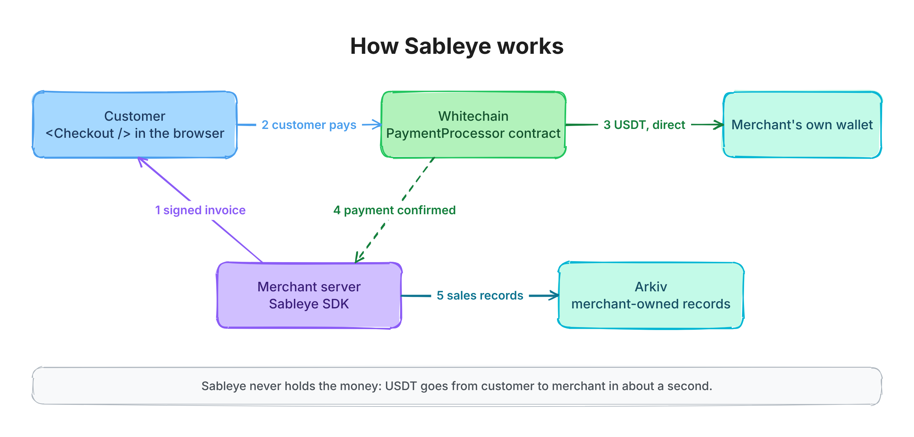
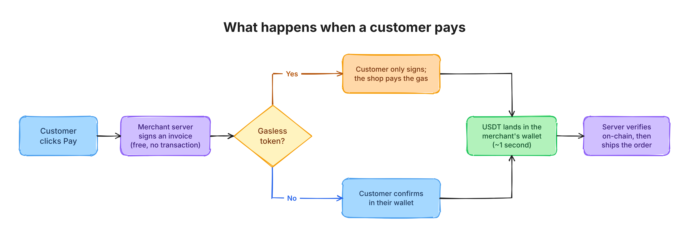
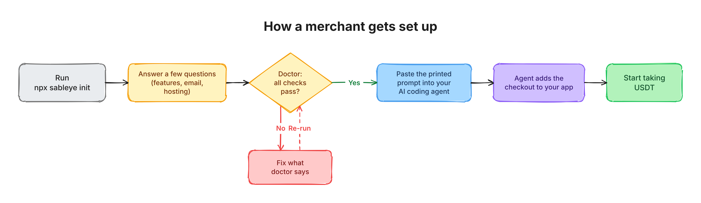
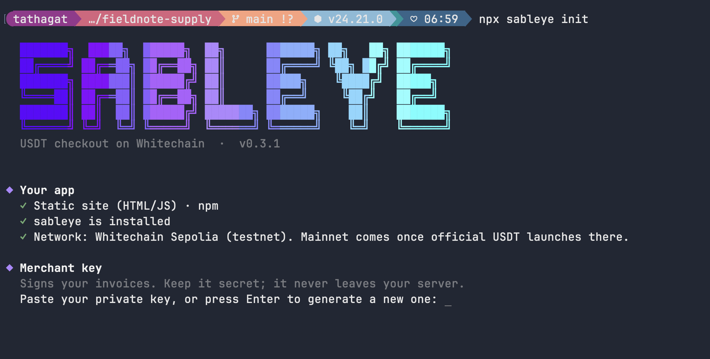
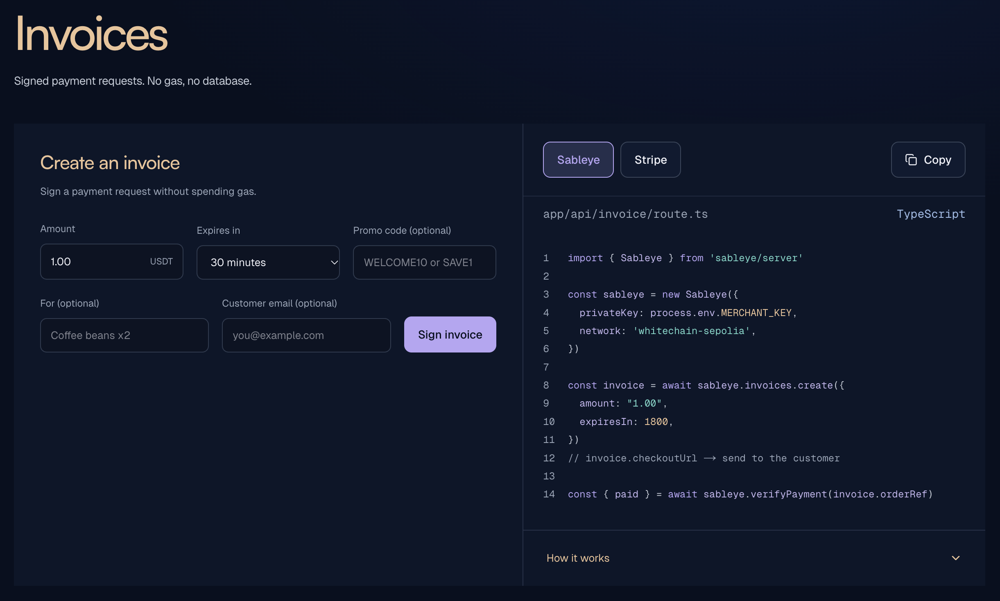
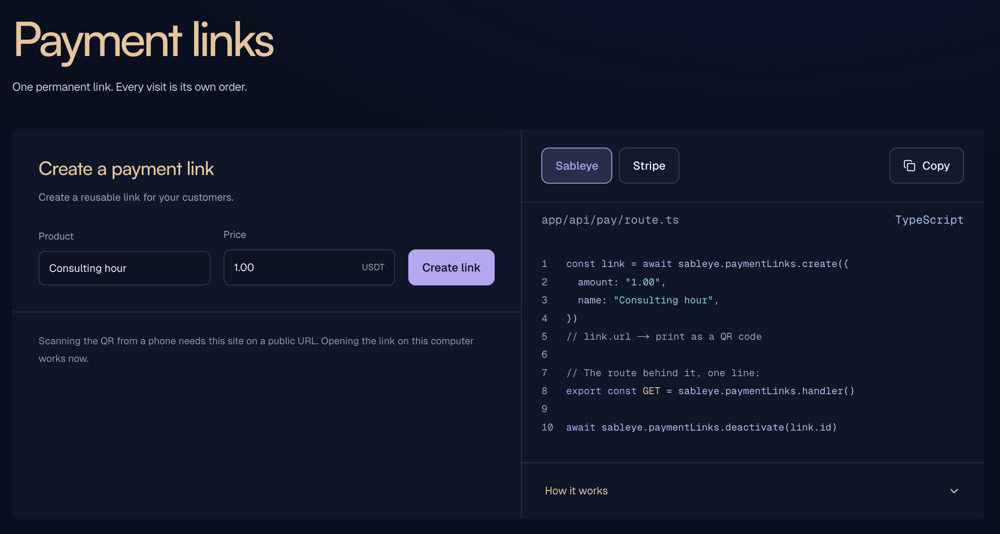

<div align="center">


# Sableye

**Stripe-style USDT checkout for real businesses, on Whitechain.**

A coffee shop, a chai stall or a SaaS adds Sableye in **≤20 lines** and gets paid in USDT, **straight into its own wallet**, in about a second. Sableye never holds the money.

[**Live Sandbox**](https://sableye.xyz/sandbox) · [**Docs**](https://sableye.xyz/docs) · [**llms.txt**](llms.txt) · [**Project overview**](project-docs/PROJECT.md) · [**Threat model**](project-docs/THREAT_MODEL.md)

</div>

---

Sableye is **B2B2C**: we serve the business, and the business serves its customers. Customers pay from any wallet. On tokens that support it, they need **no gas token at all**, because the business sponsors the fee.

```ts
import { Sableye } from 'sableye/server'
const sableye = new Sableye({ privateKey: process.env.MERCHANT_KEY, network: 'whitechain-sepolia' })

const invoice = await sableye.invoices.create({ amount: '5.00', orderId: 'order_123' }) // sign, no gas
// → render <Checkout invoice={invoice} /> or redirect to invoice.checkoutUrl

const { paid } = await sableye.verifyPayment('order_123') // fulfil only after this
```

> Built at **ETHGlobal Mumbai 2026** for the Whitechain **Operate** and **Scale** tracks. Engineering rules: [AGENTS.md](AGENTS.md).

## Contents

- [Why this needs on-chain stablecoins](#why-this-needs-on-chain-stablecoins)
- [Architecture](#architecture)
  - [System overview](#system-overview)
  - [Payment flow](#payment-flow)
  - [Invoice and subscription lifecycles](#invoice-and-subscription-lifecycles)
  - [Packages](#packages)
  - [Repository layout](#repository-layout)
- [Gasless relayer: who pays, and why it can't be drained](#gasless-relayer-who-pays-and-why-it-cant-be-drained)
- [Quickstart](#quickstart)
- [CLI](#cli)
- [Sableye Sandbox](#sableye-sandbox)
- [Documentation site](#documentation-site)
- [AI integration](#ai-integration)
- [Emails, PDFs and merchant-owned records (Arkiv)](#emails-pdfs-and-merchant-owned-records-arkiv)
- [Security and verification](#security-and-verification)
- [Deployments](#deployments)
- [Development setup](#development-setup)
- [Hosting](#hosting)
- [Merchant outreach and pilots](#merchant-outreach-and-pilots)
- [Limitations](#limitations)
- [Roadmap](#roadmap)
- [AI usage](#ai-usage)
- [License](#license)

---

## Why this needs on-chain stablecoins

A card rail like Stripe can't do any of the following:

| Card rails (Stripe) | Sableye on Whitechain |
|---|---|
| Payout in 2–7 days, with rolling reserves | **In the merchant's own wallet on block inclusion, about 1 second.** Inclusion isn't finality, so each merchant chooses pending, safe or final confirmation |
| Chargebacks, a fraud risk the merchant carries | **No chargebacks.** Merchant-issued refunds are enforced on-chain and capped at the amount paid |
| Needs a card and a bank account | Works for anyone holding USDT, including **WhiteBIT's ~40M users** |
| Unavailable in many countries | Works wherever the internet works |
| The processor holds the funds | **Non-custodial**: neither Sableye nor the contract ever holds money |

---

## Architecture

### System overview



There are four parts, and only the chain sits in the payment path:

- **Merchant server (`sableye/server`).** Holds the merchant key. Signs EIP-712 invoices off-chain, which costs nothing and sends no transaction. Verifies payments, runs the optional gasless relayer, indexes contract events (pending → safe → final), delivers signed webhooks, runs the subscription keeper, and sends invoice and receipt emails with PDFs.
- **Customer browser (`sableye/react`).** `<Checkout/>` (or the static payment-link page) checks the merchant's signature, the expiry and the contract address *before* any wallet prompt. It then picks the best path by itself: gasless, then permit, then approve.
- **Whitechain.** `PaymentProcessor` moves USDT **directly from payer to the merchant's payout wallet**, and its own token balance is always zero. `SubscriptionManager` handles recurring charges against a cap the customer authorised. Neither contract has an admin or upgrade key.
- **Arkiv.** Every paid invoice, refund and subscription is published as a record **owned by the merchant's wallet**, with private fields encrypted. The Books app reads these records and checks each one against its Whitechain transaction, with no Sableye code involved.

### Payment flow



1. **The merchant's server** signs an **EIP-712 invoice** (`orderId, merchant, payout, token, amount, expiry, nonce`). No transaction is sent.
2. **The browser** checks the invoice, then pays it with one call to `PaymentProcessor`:

   | Path | Customer experience | Who pays gas | Requires |
   |---|---|---|---|
   | `payWithAuthorization` (EIP-3009) | **Sign once, no gas token needed** | The merchant's relayer | Token supports EIP-3009 (Whitechain test USDT ✅) |
   | `payWithPermit` (EIP-2612) | One transaction, no separate approve | Customer | Token supports permit (test USDT ✅) |
   | `approve` + `pay` | Two transactions | Customer | Any ERC-20 |

3. **The contract** checks the merchant's signature (EOA or ERC-1271/Safe), expiry, revocation and "not already paid". It writes the receipt **before** moving funds, transfers the **exact** amount to the payout address (fee-on-transfer tokens are rejected) and emits `InvoicePaid`.
4. **The merchant's server** calls `verifyPayment(orderId)`, which reads the on-chain receipt, and fulfils the order.

### Invoice and subscription lifecycles

- **Invoices** only move forward: `Open → Paid → PartiallyRefunded → Refunded`, or `Open → Cancelled`. Refunds are capped at what was paid. `bumpNonce()` revokes every older unpaid invoice and payment link in one call.
- **Subscriptions** start from a merchant-signed plan and a spending cap the customer authorises. The keeper calls `charge()` once per interval, never before it's due and never above the cap. A failed charge moves the subscription to `past_due` and retries after a backoff (1 hour by default). After 3 consecutive failures, the subscription is cancelled. Either party can cancel on-chain, which stops all future charges.

### Packages

One npm package, `sableye`, with an entry point for each side:

| Import | What it does |
|---|---|
| `sableye` | Network and token config, ABI, EIP-712 types, payment links, typed errors with a `remedy`, and the framework-free checkout engine (`createCheckout`) |
| `sableye/server` | `invoices.create`, `invoices.cancel`, `verifyPayment`, relayer, indexer, webhooks, `reconcile`, CSV, subscriptions + keeper, emails, PDFs, Arkiv sink |
| `sableye/react` | `<Checkout/>` and `useCheckout`: connect → switch chain → pay → receipt, with WalletConnect / phone-wallet QR |
| `sableye/browser/checkout.js` (static asset) | `SableyeCheckout.mount()` for existing HTML/JavaScript pages without React; copy it to your public assets |
| `sableye/mcp` | MCP server for AI agents (`npx sableye mcp`) |
| `npx sableye` | CLI: `create`, `init`, `agents`, `doctor`, `view-key`, `listen`, `mcp` |
| `sdk/packages/checkout` (repo only) | Static payment-link page: no server, host it anywhere |
| `sdk/contracts` | `PaymentProcessor.sol` and `SubscriptionManager.sol`: OpenZeppelin `SignatureChecker` (EOA + ERC-1271), `SafeERC20`, reentrancy guard |

The React checkout is styled by default. Set `appearance={{ theme: 'night' }}` for dark sites, use `appearance.variables` for colours and typography, or choose `theme: 'none'` to bring your own CSS. On a site without React, copy `node_modules/sableye/browser/checkout.js` to your public assets and call `SableyeCheckout.mount(target, invoice, options)`; signing and verification still run on your backend. Guide: [`/docs/checkout/browser`](https://sableye.xyz/docs/checkout/browser).

### Repository layout

```
sdk/contracts/            Foundry: PaymentProcessor, SubscriptionManager, unit/fuzz/invariant/Halmos tests
sdk/packages/core         config, ABI, EIP-712, errors, headless checkout engine
sdk/packages/server       server SDK + CLI (bin/sableye.mjs)
sdk/packages/react        <Checkout/>, useCheckout, WalletConnect, phone pay
sdk/packages/mcp          MCP server for AI agents
sdk/packages/checkout     static payment-link page
sdk/packages/sableye      the published bundle (sableye, /server, /react, /mcp)
sdk/packages/create-sableye-app   Next.js store scaffolder
frontend/                 landing page, docs (/docs) and the Sableye Sandbox (/sandbox)
skills/sableye/           installable Agent Skill
specs/                    Quint models of the keeper and indexer
arkiv/                    Arkiv schema and judging files
project-docs/             project overview, threat model, verification, AI eval, pitch
scripts/                  ABI generation, AI-integration eval harness
```

---

## Gasless relayer: who pays, and why it can't be drained

The customer only signs. The **business's own server** submits the transaction and pays the WBT gas, about 0.0001 WBT per payment. The relayer is just the merchant key inside `sableye/server` (`export const POST = sableye.relayHandler()`). The merchant tops it up with WBT from the faucet (testnet) or an exchange (mainnet), and `npx sableye doctor` warns when the balance runs low.

**Why a stranger can't drain it:**

1. **It only relays its own invoices.** Anything not signed by this merchant is rejected before any RPC call.
2. **Each invoice can be paid exactly once on-chain**, so there's at most one sponsored transaction per invoice. Concurrent requests for the same invoice share one submission.
3. **Every request is simulated first.** Anything that would revert is refused, so no gas is spent on it.
4. **Gas is capped per transaction**, and requests are **rate-limited per IP**.
5. **The customer's authorization is bound to the invoice hash** (`nonce = hashInvoice(inv)`), and it uses `receiveWithAuthorization`, which only the processor can redeem. A relayer can't reuse it, redirect the funds or front-run it.

---

## Quickstart

One package, `sableye`. Needs Node 22 or newer.

**Existing app:** run this in its folder. It asks what you need, sets up `.env` and your coding agent, then prints a prompt that wires Sableye into your existing payment step. Paste it into Claude Code, Cursor, Codex or Copilot.

```sh
npx sableye init
```

**New store:** this scaffolds a working one.

```sh
npx sableye create --name my-store
cd my-store && npm install
npx sableye init         # merchant key, business name, email, Arkiv → .env
npx sableye doctor       # every check should pass before you sell anything
npm run dev
```

The integration it generates is three files:

```ts
// app/api/invoice/route.ts
import { Sableye } from 'sableye/server'
export async function POST() {
  const sableye = new Sableye({ privateKey: process.env.MERCHANT_KEY as `0x${string}`, network: 'whitechain-sepolia' })
  return Response.json(await sableye.invoices.create({ amount: '5.00' })) // set the price here, never in the browser
}
```

```ts
// app/api/verify/route.ts
import { Sableye } from 'sableye/server'
export async function GET(req: Request) {
  const orderId = new URL(req.url).searchParams.get('orderId')!
  const sableye = new Sableye({ privateKey: process.env.MERCHANT_KEY as `0x${string}`, network: 'whitechain-sepolia' })
  return Response.json(await sableye.verifyPayment(orderId)) // fulfil only if `paid`
}
```

```tsx
// app/page.tsx
'use client'
import { Checkout } from 'sableye/react'
import { useEffect, useState } from 'react'
export default function Page() {
  const [invoice, setInvoice] = useState<any>()
  useEffect(() => { fetch('/api/invoice', { method: 'POST' }).then((r) => r.json()).then(setInvoice) }, [])
  return invoice ? <Checkout invoice={invoice} /> : 'Loading…'
}
```

**After payment:** the checkout page is yours, so there's no `returnUrl` setting. Send the customer wherever you like from `onSuccess`, e.g. `` <Checkout invoice={invoice} onSuccess={({ txHash }) => location.assign(`/thanks?tx=${txHash}`)} /> ``, and fulfil only after `/api/verify` says `paid`.

---

## CLI



| Command | What it does |
|---|---|
| `npx sableye init` | Interactive setup: features (gasless, refunds, subscriptions…), emails (Resend or SMTP), hosting (server or serverless), checkout look, business details, Arkiv key. Writes `.env`, sets up your coding agent, runs `doctor`, and prints the agent prompt. `--yes` takes every default for CI and agents. |
| `npx sableye agents` | Regenerates the AGENTS.md block and the skill, then reprints the prompt |
| `npx sableye doctor` | Checks network, RPC, chain ID, merchant key, gas balance, processor code, that the SDK's EIP-712 hash matches the contract's, and the email login. Every failing check prints a remedy. |
| `npx sableye listen --forward-to <url>` | Watches your payments and forwards signed webhooks to localhost (`--since` replays past blocks) |
| `npx sableye view-key` | Prints the key that decrypts your Arkiv records, to share with your accountant |
| `npx sableye create --name <dir>` | Scaffolds a Next.js store |
| `npx sableye mcp` | Starts the MCP server for AI agents |

### Screenshots



<!-- TODO: add cli-doctor.png, cli-agent-prompt.png, cli-listen.png, cli-create.png and cli-view-key.png to docs/readme/screenshots/ -->

---|---|
|  |  |
| **Agent prompt printed by `init`** | **`npx sableye listen`** |
|  |  |
| **`npx sableye create`** | **`npx sableye view-key`** |
|  |  |

---

## Sableye Sandbox

**Live at [sableye.xyz/sandbox](https://sableye.xyz/sandbox).** Every product runs on Whitechain Sepolia, shown next to its code and the Stripe equivalent. Nothing is mocked.

| Page | What it shows |
|---|---|
| [`/sandbox/invoices`](https://sableye.xyz/sandbox/invoices) | Sign an invoice (0 gas, 0 tx), pay it, watch the status change |
| [`/sandbox/checkout`](https://sableye.xyz/sandbox/checkout) | The drop-in `<Checkout/>` widget, including the phone-wallet QR |
| [`/sandbox/payment-links`](https://sableye.xyz/sandbox/payment-links) | Signed links and a counter QR, where every scan is its own pay-once invoice |
| [`/sandbox/gasless`](https://sableye.xyz/sandbox/gasless) | EIP-3009 checkout: "paid by the shop, your wallet paid 0" |
| [`/sandbox/refunds`](https://sableye.xyz/sandbox/refunds) | On-chain refunds and cancellations, capped at the amount paid |
| [`/sandbox/subscriptions`](https://sableye.xyz/sandbox/subscriptions) | Plans, renewal countdown, keeper charges, past-due handling |
| [`/sandbox/events`](https://sableye.xyz/sandbox/events) | Indexer feed with pending/safe/final confirmations and signed webhooks |
| [`/sandbox/reconcile`](https://sableye.xyz/sandbox/reconcile) | Reconciliation and CSV export for the accountant |
| [`/sandbox/dashboard`](https://sableye.xyz/sandbox/dashboard) | Volume, refund rate, invoice conversion, and MRR, churn and failed-charge rate for subscriptions, all computed from on-chain data |
| [`/sandbox/merchant`](https://sableye.xyz/sandbox/merchant) | The merchant's client view, with which records are already on Arkiv |
| [`/sandbox/books`](https://sableye.xyz/sandbox/books) | The independent accountant app reading Arkiv and verifying against Whitechain |
| [`/sandbox/developers`](https://sableye.xyz/sandbox/developers) | Developer tools, including **Run doctor** |

### Screenshots

| Invoices | Payment links |
|---|---|
|  |  |

<!-- TODO: add sandbox-overview, sandbox-checkout, sandbox-gasless, sandbox-refunds, sandbox-subscriptions, sandbox-events, sandbox-reconcile, sandbox-dashboard and sandbox-books PNGs to docs/readme/screenshots/ -->

---|---|
|  |  |
| **Gasless checkout** | **Payment links + QR** |
|  |  |
| **Refunds** | **Subscriptions** |
|  |  |
| **Events & webhooks** | **Reconcile & CSV** |
|  |  |
| **Dashboard** | **Books on Arkiv** |
|  |  |

---

## Documentation site

**Live at [sableye.xyz/docs](https://sableye.xyz/docs).** It's organised into five groups:

- **Get started:** introduction, quickstart, choosing an integration, how it works, SDK configuration, networks
- **Accept payments:** React, headless, mobile and hosted checkout, WalletConnect, invoices (create, verify, cancel), payment links, gasless payments, token permissions
- **Manage payments:** coupons, emails, PDFs, storage, Arkiv records, refunds, subscriptions and the keeper, webhooks, indexer, reconciliation, finality
- **Reference:** API reference, core utilities, contracts
- **Resources:** CLI (installation, setup, listen, doctor), deployment, AI & MCP, security, errors & remedies, changelog

### Screenshots

<!-- TODO: drop the PNGs into docs/readme/screenshots/ with these names -->

| Introduction | Quickstart |
|---|---|
|  |  |
| **API reference** | **AI & MCP** |
|  |  |

---

## AI integration

`npx sableye init` sets up the merchant's coding agent as well as `.env`:

- It writes a managed Sableye block into `AGENTS.md`, with the rules and an index of the docs bundled in `node_modules/sableye/docs/`, so the docs always match the installed version.
- It adds `@AGENTS.md` to `CLAUDE.md` and installs the skill in `.claude/skills/sableye/`.
- It prints a prompt that names the skill.

That's the layout [Vercel's agent evals](https://vercel.com/blog/agents-md-outperforms-skills-in-our-agent-evals) found most reliable.

**Measured:** we tested four real-shaped merchant apps, each with its own fake payment step: a Next.js shop on Vercel (serverless), the same shop on Railway (long-running), an Express shop, and a static HTML site. Each was set up with the real `npx sableye init --yes`, and Claude Code got only the prompt it printed. **12/12 trials passed** all nine automatic checks: server-side signing and verification, the key never reaching the client, the configured features wired up, the app building and serving, `doctor` passing, and **no new buttons, fields or pages**. Details and reproduction: [project-docs/AI_EVAL.md](project-docs/AI_EVAL.md).

**MCP server** (`npx sableye mcp`): `get_invoice`, `list_invoices`, `stats`, `export_csv`, `doctor`, `create_invoice`, `create_payment_link`, and `prepare_refund`. `prepare_refund` returns an **unsigned** transaction for the merchant to approve, so no agent ever holds spending power.

Also for agents: [`llms.txt`](llms.txt) has every API with an example, and [`skills/sableye`](skills/sableye/SKILL.md) is an installable Agent Skill.

---

## Emails, PDFs and merchant-owned records (Arkiv)

**Email.** `npx sableye init` offers Resend, SMTP or no email, sends you a test email, and saves the details to `.env`. Resend uses `SABLEYE_RESEND_API_KEY` and a verified sender in `SABLEYE_EMAIL_FROM`; SMTP uses `SABLEYE_SMTP_USER` / `SABLEYE_SMTP_PASS`. Change it later with `npx sableye init --email`. From then on:

- customers get the **invoice** (with a PDF) and the **receipt** (with a PDF, sent after on-chain confirmation);
- you get a **"you got paid"** notice;
- refunds send a **refund confirmation**.

Emails go through a keyed retry outbox: retained keys suppress duplicates (though a crash at the wrong moment means delivery isn't guaranteed exactly once), and a provider failure never reverses a payment. On serverless, finish due jobs with `await sableye.emails.flush()`; future retries need a durable worker or cron. PDFs are also available directly: `sableye.documents.invoicePdf(ref)` / `receiptPdf(ref)`.

**Arkiv.** With `ARKIV_ACCESS_KEY` set, the indexer publishes every safe invoice and refund to Arkiv (testnet "Rabdi"), and syncs subscription snapshots (cycles, total charged, status) every two minutes. Writes are **signed by the merchant key**, so the merchant's wallet owns the records. Persist the publisher state and outbox, and keep the worker running.

- **Public fields** hold only what's already public on Whitechain: amount, token, payer, tx hash and time.
- **Encrypted fields** hold the order reference, items and customer, using the merchant's view key (`npx sableye view-key`).
- **Anyone can read the records without us.** `/sandbox/books` does it in the browser with no Sableye code.
- **Docs:** schema in [`arkiv/schema.md`](arkiv/schema.md); background in [`why-arkiv.md`](arkiv/why-arkiv.md), [`how-you-use-arkiv.md`](arkiv/how-you-use-arkiv.md), [`reach.md`](arkiv/reach.md) and [`friction.md`](arkiv/friction.md).
- **Writing wallet (sandbox merchant):** `0xF9B1a7c3374ca8d2AC63aca87D9664aa2E0bEE08`

<details>
<summary>Query the records yourself</summary>

```ts
import { createPublicClient } from '@arkiv-network/sdk'
import { rabdi } from '@arkiv-network/sdk/chains'
import { desc } from '@arkiv-network/sdk/query'
import { addr, bytes, defineSchema, str, u256, u64 } from '@arkiv-network/sdk/schema'
import { http } from 'viem'

const Invoices = defineSchema('sableye.invoice.v1', {
  order_id: str().indexed(), merchant: addr().indexed(), status: str().indexed(), network: str().indexed(), chain_id: u64(),
  token: addr().indexed(), amount: u256().indexed(), paid_at: u64().indexed(), payer: addr(), payout: addr(),
  tx_hash: str(), refunded: u256(), private: bytes().optional(),
})
const arkiv = createPublicClient({ chain: rabdi(), transport: http() })
const { entities } = await arkiv.select().from(Invoices)
  .ownedBy('0xF9B1a7c3374ca8d2AC63aca87D9664aa2E0bEE08').orderBy(desc('paid_at')).limit(20).fetch()
```

</details>

---

## Security and verification

**Contract invariants**

- The processor never holds tokens.
- Refunded ≤ paid.
- An invoice can't be paid twice.
- Status only moves forward.

**How they're checked**

- **Tests:** unit and fuzz tests, plus Foundry invariant tests (256 runs × 64 calls of random pay/refund/cancel/nonce-bump). Token-variant mocks cover approve with no bool return, fee-on-transfer and blacklisting.
- **Static analysis:** Slither runs clean in CI, and every suppressed finding has its justification written next to it.
- **Formal verification:**
  - 17 Halmos symbolic proofs cover every money path in both contracts, each checked against planted bugs.
  - The solc SMTChecker found no counterexamples.
  - Gambit mutation testing found 25 test gaps, now covered.
  - Quint models of the keeper and indexer found 5 SDK bugs, all fixed with regression tests.

**Built into the SDK and checkout**

- The merchant key never leaves the server: the SDK throws `secret_in_client` if it's used in a browser.
- The checkout checks the merchant's signature and the contract address before any wallet prompt, so a forged link can't get a customer to approve tokens to an attacker.

What's proved, what's tested and what isn't covered: [project-docs/VERIFICATION.md](project-docs/VERIFICATION.md). Full threat model: [project-docs/THREAT_MODEL.md](project-docs/THREAT_MODEL.md).

---

## Deployments

| Network | Contracts | Explorer |
|---|---|---|
| Whitechain Sepolia (1874) | PaymentProcessor `0x8312552Ec716F0c159D88F73230Fff98C4aeCfB5` · SubscriptionManager `0x4E2571F08f6399b769F5F04ED7a54CE55729Bb78` | [processor ✅ verified](https://explorer.testnet.whitechain.io/address/0x8312552Ec716F0c159D88F73230Fff98C4aeCfB5?tab=contract) · [subscriptions ✅ verified](https://explorer.testnet.whitechain.io/address/0x4E2571F08f6399b769F5F04ED7a54CE55729Bb78?tab=contract) |
| Whitechain mainnet (1875) | _Pending: official USDT isn't on mainnet yet_ | |

Both contracts are **fully verified** on the Whitechain explorer (exact match, Solidity 0.8.30), deployed from commit `6213a42` (`sdk/contracts/broadcast/Deploy.s.sol/1874/run-latest.json`). The verified source is byte-identical to `sdk/contracts/src` in this repo, including the OpenZeppelin dependencies, so the code on the explorer is the code that's tested and formally verified here.

**Real USDT payment:** 1 USDT for order `chai_order_3`, paid through the hosted checkout with `payWithPermit` (one transaction, no approve): [0x4229f7de…c4e9](https://explorer.testnet.whitechain.io/tx/0x4229f7de327de2a1c9e48660cc225483cba6430e3ec5ee51152ed4a99149c4e9). Payer `0x3Cf8…897a` → merchant `0xF9B1…EE08`; the processor's balance stayed 0.

**Testnet funds:**

1. Get WBT for gas from <https://faucet.testnet.whitechain.io> (2 WBT/day).
2. Swap WBT for USDT on <https://testnet.yetitrade.fi>.
3. Pay with USDT `0xcedfB56113143d55b2358b8CFbB0dEB5Ad2f55a7`.

---

## Development setup

```sh
git clone --recurse-submodules https://github.com/AnInsaneJimJam/sableye
cd sableye
pnpm install && pnpm build
cd sdk/contracts && forge test        # unit, fuzz, invariant and token-variant tests
pnpm --filter @sableye/server test     # end to end on anvil: deploy → create → pay → verify
pnpm --filter @sableye/react test      # <Checkout/> in a DOM, clicking through a real payment on anvil
pnpm --filter @sableye/checkout test   # the built payment-link page
pnpm --filter create-sableye-app test
cd frontend && pnpm dev                # landing page, docs and Sandbox on :3000
```

After any contract change, run `(cd sdk/contracts && forge build) && node scripts/gen-abi.mjs`.

---

## Hosting

- **Full Sandbox** (indexer, receipts, dashboard, events, reconcile, subscription keeper, Arkiv publishing): Railway, as one always-on Node server with a volume at `frontend/.sableye/`.
  - Config is in `railway.json` and `.railwayignore`.
  - It deploys automatically on every push to `main`. `railway up` deploys the local tree by hand.
  - Set `MERCHANT_KEY`, `NEXT_PUBLIC_SITE_URL` and `NEXT_PUBLIC_REOWN_PROJECT_ID` as service variables, and optionally `SABLEYE_SMTP_*` / `ARKIV_ACCESS_KEY`.
- **Live:** <https://sableye.xyz> runs the frontend, API routes and background workers in one process.
- **Vercel** can host the static parts (landing page, Books, invoices, checkout). Features that need the indexer return `503 persistent_storage_required` there.

---

## Merchant outreach and pilots

We're building Sableye with real businesses, not just for judges. We're contacting merchants directly to find early pilots and learn what they need before mainnet.

### Where we are

| Stage | Count |
|---|---|
| Businesses contacted by email | **~200** |
| In active conversations | **3** |
| Pilots live on testnet | _TBD_ |
| Live on mainnet | 0 (waiting for official USDT on Whitechain mainnet) |

### Who we're talking to

Sableye fits businesses that already have customers holding USDT, or that card rails serve badly:

- **Cafés, chai stalls and small retail:** one QR on the counter, with each scan a pay-once invoice, and money in the wallet in a second.
- **Online stores:** a drop-in checkout with refunds, emailed receipts and a CSV for the accountant.
- **SaaS and memberships:** on-chain subscriptions with a spending cap the customer controls.
- **Merchants that Stripe doesn't serve**, or whose customers have no card, including the ~40M WhiteBIT users who already hold USDT.

### Active conversations

<!-- TODO: fill in once each business agrees to be named; otherwise keep it anonymous by segment -->

| # | Business (or segment) | Use case | Stage | Next step |
|---|---|---|---|---|
| 1 | _TBD_ | _TBD_ | _TBD_ | _TBD_ |
| 2 | _TBD_ | _TBD_ | _TBD_ | _TBD_ |
| 3 | _TBD_ | _TBD_ | _TBD_ | _TBD_ |

### What a pilot merchant gets

- **Hands-on integration.** We run `npx sableye init` with you and wire the checkout into your existing payment step. It's about 20 lines of code, or a payment-link QR with no code at all.
- **A testnet trial first** on Whitechain Sepolia, then a move to mainnet as soon as official USDT launches there.
- **Your money and your records stay yours.** Payments land in your own wallet, and your sales records are owned by your wallet on Arkiv.
- **A direct line to the team** to request features. Pilot feedback decides the roadmap.

### What we're hearing

<!-- TODO: add the top 3–5 themes from replies and calls (objections, must-have features, pricing questions) -->

- _TBD_

### Run a business and want to try it?

Open an issue on this repo, or email us at _TBD_. <!-- TODO: contact email -->

---

## Limitations

- **USDT only.** Official USDT isn't on Whitechain mainnet yet, so production use waits for that bridge.
- **Refunds pull from the payout address**, which must approve the processor first.
- **Finality is a trade-off.** `safe` lags the chain tip by about 19 minutes. The SDK reports pending, safe and final states, and each merchant chooses which one to fulfil on.
- **The issuer can blacklist addresses** and the chain depends on Whitechain's OP Stack sequencer. Both are outside our control.

## Roadmap

1. **Phase 1, core SDK:** accept, operate (refunds, webhooks, CSV), scale (gasless, subscriptions). ✅ Built.
2. **Phase 2, Arkiv:** merchant-owned, partly encrypted records and the Books app. ✅ Live on testnet.
3. **Phase 3, Swarm:** host the checkout, dashboard, Books and receipts on Swarm so payment links keep working even if our domain goes down.
4. **Phase 4, assurance:** extend the formal verification, and get Certora access if possible.
5. **Mainnet launch** on Whitechain (chain 1875) as soon as official USDT is live, with pilot merchants first.

## AI usage

Much of this project was written with AI coding assistants (Claude Code), with human review. Every contract change was checked by tests and Slither.

## License

[MIT](LICENSE)
